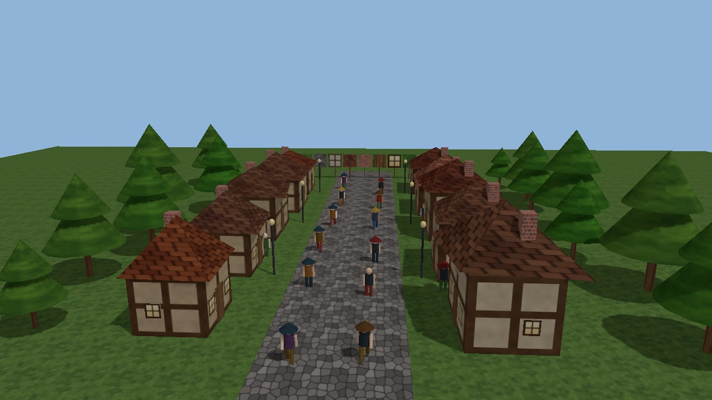

# three.c3

A 3D engine you script in JavaScript. The API is shaped like [Three.js](https://threejs.org), the
renderer is native Vulkan, and it is one binary — no browser and no Node.



*[`examples/village.js`](examples/village.js) — one script, with every texture generated in code.*

A first scene:

```js
const scene = new three.Scene();

const cube = new three.Mesh(new three.BoxGeometry(1, 1, 1));
cube.color = 0xff8800;
scene.add(cube);

three.camera.frameAll();
```

```sh
./build/three --script hello.js
```

### Get it

Prebuilt binaries for macOS arm64 (macOS 26 or newer), Linux x64 and Windows x64 are on the
[releases page](https://github.com/tonis2/three.c3/releases). Unzip and run `./three`.

To build it yourself, see [Building](#building). A build lands in `./build/three`, which is the
path the commands below use.

### Features

- **Vulkan renderer** — instancing, shadows, skinning, post-processing, sky
- **glTF** — load a `.glb` or `.gltf`, place the whole file or single pieces of a kit
- **Custom shaders** — written in shady, compiled at startup, as a material or a post pass
- **KTX textures** — compressed, transcoded on load
- **Animation** — clips, skeletal skinning, instanced crowds
- **Physics** — rigid bodies, joints, heightfields
- **Navigation** — baked fields for characters to find their way over
- **UI** — declared from JavaScript classes
- **VR** — Meta Quest 3, with the hands emulated by mouse and keyboard at a desk
- **MCP server** — a coding agent runs scripts and sees the frame they drew

### Examples

Identical meshes are instanced for you, and a material can carry its own shader:

```js
const scene = new three.Scene();

// 81 cubes. The same geometry is the same asset, so this grid is one draw call.
for (let x = -4; x <= 4; x++) {
  for (let z = -4; z <= 4; z++) {
    const cube = new three.Mesh(new three.BoxGeometry(1, 1, 1));
    cube.position.set(x * 1.5, 0, z * 1.5);
    cube.scale.y = 1 + Math.abs(x + z) * 0.4;   // scaling keeps it in that draw call
    scene.add(cube);
  }
}

const ball = new three.Mesh(
  new three.SphereGeometry(1.2, 48, 24),
  new three.ShaderMaterial({
    uniforms: { tint: [1, 0.4, 0.2] },
    fragment: "return lambert(s, s.normal) * s.uniforms.tint;",
  }),
);
ball.position.y = 3;
scene.add(ball);

three.camera.frameAll();
three.debug.write(scene.stats());   // { drawCalls: 2, uniqueMeshes: 2, instances: 82, ... }
```

Loading a model and moving it every frame:

```js
const scene = new three.Scene();

const truck = three.load("truck.glb").instantiate();
scene.add(truck);

three.setAnimationLoop((ms) => {
  truck.rotation.y = ms / 1000;
});

three.camera.frameAll();
```

[`examples/`](examples/) holds complete scenes and small games. Each file opens with a comment on
what it shows and which keys it answers to.

| Script | What it is |
| --- | --- |
| [`village.js`](examples/village.js) | A street of houses and a crowd, every texture generated in code |
| [`village_walk.js`](examples/village_walk.js) | Walk a villager through a village of parallax-mapped surfaces |
| [`wumpa_run.js`](examples/wumpa_run.js) | A platformer: terrain, crates, pickups, critters that path-find to you |
| [`tank_yard.js`](examples/tank_yard.js) | A top-down tank game that plays itself when left alone |
| [`fireflies.js`](examples/fireflies.js) | A night-time chase in a walled garden |
| [`pop.js`](examples/pop.js) | A click game whose interface is a handful of classes |
| [`vfx.js`](examples/vfx.js) | Effect materials that sample their own textures |
| [`storage_images.js`](examples/storage_images.js) | Compute shaders writing images, and a post chain |
| [`editor.js`](examples/editor.js) | A kit editor with an asset browser, for a folder of `.glb` files |
| [`vr_castle.js`](examples/vr_castle.js) | Knock a toy castle off a table in VR: both hands, lamps, physics |

All but the editor build everything they draw in code, so they run on a clean checkout. The editor
wants a kit: `./build/three --assets your-kit --script examples/editor.js`. A whole VR game built on
the engine lives in its own repo: [Tabletop Siege](https://github.com/tonis2/tabletop-siege).

### Running

```sh
./build/three --script examples/village.js   # one script, then keep the window up
./build/three --assets mygame                # boot mygame/main.js as a module
./build/three --screenshot shot.png          # render one frame and exit
./build/three --debug                        # validation, logging, Shift+R to reload
./build/three --help                         # every flag
```

### Agents

```sh
./build/three --mcp        # agent tools on 127.0.0.1:8808
```

`.mcp.json` in this repo already points there, so an agent session in a checkout picks it up.
There are two tools:

- `run_script` runs a script and answers with what it logged, the scene's stats and a PNG of the frame.
- `screenshot` renders the current scene again.

The agent reads the API from [`docs/`](docs/); `run_script`'s description tells it where that is.

### Meta Quest 3

```sh
./setup.sh android                                           # once: the OpenXR loader
packaging/android/build-apk.sh examples/vr_castle.js --run
packaging/android/quest.sh push examples/vr_castle.js        # reloads in place, no rebuild
packaging/android/quest.sh mcp                               # the agent tools, on the headset
packaging/android/quest.sh logs
```

Needs the Android SDK and NDK (`ANDROID_HOME`) and a headset in developer mode on USB.

In a script the hands are `three.xr.left` and `three.xr.right`, and `three.xr.passthrough` shows the
room. Set `three.xr.emulate = true` to try a VR scene at a desk, with the mouse and keyboard as the
hands. See "The headset" in [`docs/functions.md`](docs/functions.md).

### Building

Needs [c3c](https://github.com/c3lang/c3c) — the releases are built with v0.8.5_1.

```sh
git clone --recursive https://github.com/tonis2/three.c3.git
cd three.c3
./setup.sh
c3c build
```

`setup.sh` fetches the submodules and, on macOS arm64, the Vulkan loader and driver. It is safe to
re-run.

For a release build: `c3c build --safe=no -O3 -g0`

### Documentation

The API reference is [`docs/`](docs/). Start with [differences](docs/differences.md) — where this
is not Three.js, and where scripts that fail usually fail.

MIT licensed.
